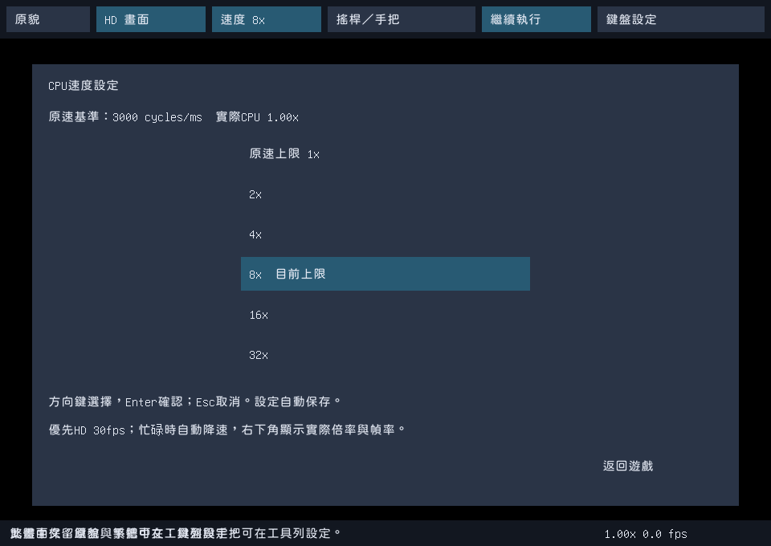
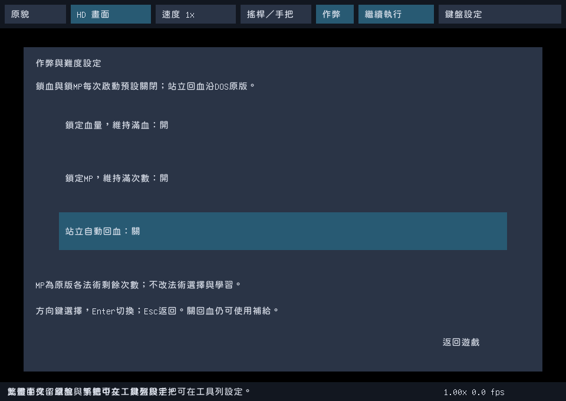
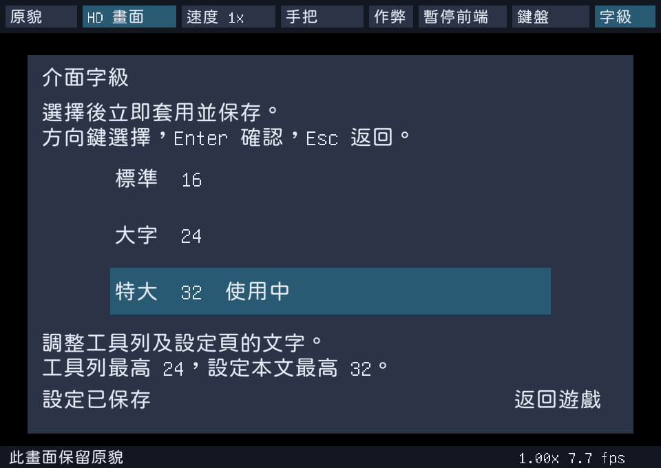

# 神劍封魔 Zeliard

## 遊戲簡介

《神劍封魔》是一款橫向動作角色扮演遊戲，結合城鎮交談、裝備補給與地下迷宮探索。玩家以劍和魔法迎戰怪物，運用跳躍、攀繩與蹲下穿越洞窟，在岔路與平台之間尋找前進的道路。

城鎮是冒險的補給站。向居民打聽消息，到商店選購武器與魔法物品，再帶著準備好的裝備進入迷宮。探索、戰鬥、回城整裝，構成遊戲的主要節奏；途中取得的金幣與寶石，也能用來支應下一段旅程。

## 故事背景

公主遭邪惡的魔龍化為石像，王國的繁榮也受到威脅。為了拯救公主，你接受邪靈的挑戰，帶著人民的期待與神靈的祝福，踏入地下迷宮。

從城鎮出發，居民的消息、商店的裝備與手中的劍，都是迎向未知的準備。離開有人煙的地方後，等待你的是錯綜的洞窟、盤踞其中的怪物，以及必須親自闖過的險路。救回公主的旅程，就從這一步開始。

故事與城鎮探索描述改寫自當年中文手冊《神劍封魔》第1頁「前言」、第6頁操作說明及第7至10頁「開始遊戲」與商店介紹；動作描述亦依本專案已實際走過的第一洞窟操作。手冊來源為`珍084-神劍封魔.rar`內的`珍084-神劍封魔/SCAN0357_003.jpg`、`SCAN0357_005.jpg`、`SCAN0357_006.jpg`及`SCAN0357_007.jpg`。原文核對與雜湊見[手冊證據](RESEARCH-LOG.md#2026-10-18輸入盤點與中文手冊初讀)，掃描檔留在本機。

## 繁體中文與 HD 版本

使用 dosgolem 直接執行 DOS《神劍封魔》，在原版畫面上疊加繁體中文與 HD，並加入可綁定藍牙、USB 手把的工具列。執行與覆繪參考《銀河超能力戰記》中文化專案，工具列參考《三國演義》重製版。

本機新版1.0.7提供「原版＋中文（CHT）」及「原版＋中文＋HD（CHT-HD）」兩套三平台完整包。這一版把結局的敘述、製作名單、登場魔物與版權譯成中文；開局兩側柱子逐格畫出、第一次進城堡與F7讀檔選單期間都維持HD；狀態列地名、房間標題與alma寶石也改成「中文（English）」。前一版1.0.6已讓翻譯文字直接以中文出現、人像不與原版交替，並修正Windows跨磁碟啟動。CHT保留原版美術，不附HD圖庫；CHT-HD預設開啟手繪HD，可從工具列切回原貌。兩版都包含原版遊戲、圓體中文、配樂音色改善、CPU速度、系統字級及鍵盤／手把設定，存檔相容，並保留啟動進度、HD按需載入、生命／MP鎖定與站立回血開關。新版內容見[規格067](docs/spec/067-start-menu-ending-presentation.md)與[規格066](docs/spec/066-glyph-patch-stable-presentation.md)，既有功能範圍見[060](docs/spec/060-player-cheats.md)、[061](docs/spec/061-startup-on-demand-hd.md)、[062](docs/spec/062-stable-hd-presentation.md)及[064](docs/spec/064-readable-system-text.md)。

HD 圖樣搜尋已加速，並補上持盾受擊後特殊姿態的高清接入。正常接敵變色與後續姿態均保留 HD 背景和角色，原版移動速度與規則不變。修正與驗證範圍見[規格052](docs/spec/052-hd-runtime-damage.md)。

| 範圍 | 目前狀態 |
|---|---|
| 城鎮與室內 | 沿用既有場景，補齊八種室內圖庫、居民、城鎮地形及交談後景；接縫、遮擋與正常到達待人工驗收 |
| 洞窟 | 沿用11組地形、門框與物件；八組敵人、十組首領及第二階段模板均有HD圖面 |
| 主角與武器 | 保留既有完整姿態，加入主角230個原生圖塊與三組刀光301個圖塊的組裝；未知來源安全退回 |
| 片頭、結局與介面 | 已接入補繪插畫、頭像表情、幻影階段、結局合成、裝備物品圖示與法術效果 |
| 整合狀態 | 前版1.0.4完成正常F7、居民中文與第一洞窟限定HD實錄；1.0.6、1.0.7以既有正常鍵序核對字形改寫、英文露出與HD交替，結局以直接觸發驗證，並核正式包啟動，不重跑通關、音訊或實體手把 |
| 平台封包 | 兩版各有Linux AppImage、Windows ZIP及macOS通用ZIP；各平台核對範圍見驗證矩陣，不以交叉建置當真機驗收 |

HD版收錄已盤點的城鎮、室內、洞窟、人物、敵人、首領、裝備法術、片頭與結局補圖，來源與接入見[規格050](docs/spec/050-manual-hd-delivery.md)。未知或不符來源保留原貌；不以完整資料包或第一洞窟錄影宣稱全遊戲翻譯、每幀HD或完整通關已驗收。

中文採用較圓潤的[jf open 粉圓2.1](https://github.com/justfont/open-huninn-font/releases/tag/v2.1)，在工具列、對話、選單與狀態列依顯示尺寸合成柔邊，保留原字距及文字區域。字型採OFL-1.1，授權全文隨本機包附上。製作方式見[字型工具](tools/prepare_rounded_font.py)。

配樂改用原版 AdLib 驅動與可替換的 Nuked-OPL3 音源，保留原曲。封包採實際時間推進，卡頓時最多追趕100毫秒，暫停及失焦不追趕。1.0.7兩版均通過Linux原生啟動與Wine輔助啟動；本次啟動檢查關閉音訊，未重驗播放品質。實體USB／藍牙手把、Windows與macOS真機尚未驗收。詳見 [VERIFICATION-MATRIX.md](VERIFICATION-MATRIX.md)。

啟動後先顯示準備視窗，列出目前階段、耗時與錯誤。HD的城鎮、室內及洞窟圖組在首次進入該類場景時準備，補圖在首次匹配時核對並解碼，之後使用快取。場景載入期間暫停遊戲與音訊，完成後繼續；啟動日誌為使用者設定目錄內的`startup.log`。這會縮短開始等待，首次進入場景仍可能短暫顯示載入頁。

## 原版與 HD 畫面


左側為原版美術，右側為手繪 HD。每組取自同一暫停狀態的實際視窗，兩側皆開啟繁體中文覆繪。教堂圖展示當時的肖像覆繪，邊框與狀態列仍保留原貌；這些截圖只呈現已驗證的場景。


前版封包的 Muralla 城鎮與 Malicia 第一洞窟實際截圖，保留工具列與狀態列。可從工具列切換原貌／HD、選擇手把及設定鍵盤。這兩張遊玩畫面保留前版，1.0.2實錄見下方推廣片；1.0.3新增的速度設定頁見下圖。

### 工具列新增速度調整



1.0.3在上方工具列新增「速度」，原貌中文版與HD版都可選擇 **1×／2×／4×／8×／16×／32×**。可用滑鼠點選，或用方向鍵選擇後按Enter確認；Esc返回，設定自動保存。

所選倍率是CPU速度上限。負載高時會自動降速，右下角顯示實際倍率與fps，以HD 30fps為目標。上圖取自1.0.3完整包，示範選擇8×上限；設定頁暫停原版，圖中的fps不代表HD遊玩效能。[截圖來源與雜湊](docs/images/cpu-speed-provenance.json)可回查實際封包及[擷取工具](tools/capture_speed_readme.py)。

### 生命、MP與站立回血



上圖取自1.0.4完整HD AppImage的實際視窗，示範開啟生命及MP鎖定、關閉站立回血；設定頁暫停原版，圖中fps不代表遊玩效能。[截圖來源與雜湊](docs/images/cheat-settings-provenance.json)可回查封包及操作工具。

上方「作弊」有三個獨立開關：鎖滿生命、鎖滿MP、站立自動回血。前兩項每次啟動預設關閉；站立回血預設開啟，關閉後會保存設定。開啟鎖滿生命時，生命鎖定優先。這些選項只在已確認的原版來源上生效。

本遊戲的MP是各法術剩餘使用次數，鎖滿MP會補至各自上限，不會取得尚未學會的法術。關閉站立回血只抑制DOS版自然恢復，教堂與補血道具仍有效；可提高難度，未宣稱完整重現PC-88版規則。啟用作弊會改變原版數值，正常存檔仍由原版保存。

### 可調整的系統字級

1.0.5兩種版本的上方工具列都有「字級」，可選 **標準16／大字24／特大32**，立即套用並自動保存。設定本文預設24像素，工具列最高24；選擇16可還原原有大小。遊戲內對話與原版畫面不受影響。操作與範圍見[規格064](docs/spec/064-readable-system-text.md)，啟動使用下方正式包或 `bash tools/play.sh`。



上圖取自1.0.5正式HD AppImage，另見[特大字作弊頁](docs/images/system-text-v105.png)。設定頁暫停原版，圖中fps不代表遊玩效能。[截圖來源](docs/images/system-text-v105-provenance.json)可回查二進位與設定。字級切換及冷重開已核對，未重新驗通關或幀率。

### 1.0.7：結局中文、開局與F7維持HD

結局的敘述、製作名單、登場魔物與版權現在以中文顯示，與片頭故事同樣隨原版逐字出現。製作名單的職稱譯成中文，日籍工作人員可從外部資料查到漢字的寫成「漢字（English）」，查不到或來源有衝突的保留英文；依據見[規格067](docs/spec/067-start-menu-ending-presentation.md)。

HD版開局時，原版一格一格畫出兩側柱子，現在每畫好一格就顯示該格的HD柱子，不再先出現原版；第一次進城堡時，城牆畫完前維持上一個畫面，畫完直接換成HD。按F7開讀檔選單時，城鎮與洞窟的背景都維持HD，只有選單框是原版樣式加中文。結局人物說話時，整張比對到的肖像與插畫維持HD，不再露出原版嘴型小圖；沒有HD的肖像（例如公主在對話畫面的姿態）整框顯示原版，不拼成格子。

狀態列的地名改成「穆拉亞（Muralla）鎮」這種寫法，欄位不夠時延伸到兩側空白處；洞窟房間標題寫成「賈辛（Jashiin）殿」，alma寫成「靈魂寶石（alma）」，片頭故事與首章捲字中的英文專名也一併改寫。地名與人名的中文都是試譯。

仍保留的限制：結局部分插畫的HD素材對不上原版畫面，例如加蘭離城那張有幾塊原版格子、公主在對話畫面的姿態沒有HD，最後一張FIN插畫顯示原版；片頭陽台插畫柱腳的棋盤格也還沒改。結局是以直接觸發結局模組驗證，不是正常通關。

### 1.0.6：不先閃英文、人像不交替、補齊中文

原版畫英文字的程式只改三處目的段位址，另存成使用者目錄內的副本，原始遊戲檔不變。已翻譯的文字由原版畫到看不見的記憶體段，畫面上直接出現中文；沒有譯文的文字照原版顯示。進國王、道具店、銀行與教堂時，人像在原版逐格揭開期間就顯示HD，不再出現原版與HD拼成的馬賽克。片頭故事按Space跳過、以及離開房間時，原版會逐點把畫面清黑，HD與中文現在跟著同步消失，不會露出原版插畫或英文；居民對話開框時，原版畫框前城鎮維持HD。

缺譯的國王與長老對話、武器店與道具店說明、銀行匯率、旅館、洞窟拾取訊息、首領台詞與標題版權已補成中文。人名、地名與法術的專有名詞寫成「中文（English）」，除手冊已有的名稱外都是試譯。

1.0.6當時保留的開局揭開、F7選單、結局未譯與狀態列專名，已在1.0.7處理。驗證範圍見[規格066](docs/spec/066-glyph-patch-stable-presentation.md)。

## 素材總覽

以下兩張圖保留前版相同的16個類別，展示當時接入的原版來源與HD圖面。人物各取一個姿態，主角、武器及動態物件採圖集抽樣；城鎮地面與洞窟岩壁的原版圖取自場景。本批未重新抽樣或拍攝，這兩張圖不能代表新增素材的完整範圍。

### 原版素材總覽


### HD 素材總覽


圖面來源、裁切範圍與 SHA-256 保存於 [圖片來源清單](docs/images/provenance.json)，由 [製圖工具](tools/readme_images.py) 從本機素材重建。本頁圖片是依使用者要求加入的文件預覽；原版與衍生美術不適用自有程式的授權，完整解析度素材仍留在本機。

### 怪物與魔王總覽


每組左側為原版，右側為手繪 HD 素材，已將零散圖格重組為完整角色。上圖涵蓋八個區域的30組代表姿態，下圖展示10組首領姿態，包含魔王的披風與戰鬥兩種姿態；數量不等於敵人種類數。

章魚、飛鳥、魔像、獨眼魔與披風魔王採完整構圖重繪，再裁出動畫元件，總覽與遊戲使用同一份圖。魔像保留原版藍白色塊造型；獨眼魔的皮膚及魔王披風連續繪製，移除分格接縫。尚未由完整圖涵蓋的動畫元件保留原貌，詳見[首領美術範圍](docs/spec/058-coherent-boss-hd.md)。

這些是素材重組圖，後段實際出場與完整動畫仍待人工檢視。首領標題依外觀描述，不作官方譯名。布局參考Kuro-chan整理、由[nolanvenhola/zeliard](https://github.com/nolanvenhola/zeliard/tree/c23b5f91ad31eb75b2f63a312a42e161e26096d8/4_Resources/Sprites/SpritersResource)保存的圖集與地圖；輸出像素取自本地原版與既有HD素材。固定布局見[重組配置](docs/images/creatures-layout.json)，來源與雜湊見[總覽來源清單](docs/images/creatures-provenance.json)，可用[製圖工具](tools/readme_creatures.py)重建。

## 開始遊玩

本機完整版放在 `dist-all/v.1.0.7-20261023/full-local/`，包含遊戲資料，未上傳GitHub。檔名以`Zeliard-v.1.0.7-20261023-`開頭：

| 平台 | 原版＋中文 | 原版＋中文＋HD |
|---|---|---|
| Linux x86_64 | `CHT-Linux-x86_64.AppImage` | `CHT-HD-Linux-x86_64.AppImage` |
| Windows x86_64 | `CHT-Windows-x86_64.zip` | `CHT-HD-Windows-x86_64.zip` |
| macOS Intel／Apple Silicon | `CHT-macOS-universal.zip` | `CHT-HD-macOS-universal.zip` |

前版封包保留在各自版號目錄。新版沿用1.0.2的HD入洞過場與五組完整構圖首領、1.0.3的CPU速度、1.0.4的啟動與HD穩定修正、1.0.5的可調字級、1.0.6的字形改寫與補譯，再加入結局中文與開局、F7的HD維持。美術範圍見[過場修正](docs/spec/057-cave-transition-hd.md)與[首領美術](docs/spec/058-coherent-boss-hd.md)。

Windows解壓縮後開啟`Zeliard.exe`，macOS開啟`Zeliard-CHT.app`或`Zeliard-CHT-HD.app`。Linux可直接執行所選AppImage，也可在專案目錄啟動HD版：

```sh
bash tools/play.sh
```

原貌中文版使用`bash tools/play.sh --cht`。兩套包分開提供，安裝位置不影響共用存檔格式。

原生封包不需要Docker。若Linux缺少FUSE，可在新目錄以AppImage的`--appimage-extract`解開，再執行`squashfs-root/AppRun`。1.0.7兩版均以此方式通過啟動及獨立存檔目錄檢查。

工具列可開啟「搖桿／手把」及「鍵盤設定」，HD版另可切換原貌／HD。藍牙先在系統配對，USB手把先插入，再選裝置及綁定。鍵盤可重綁、解除、還原預設，兩種設定都會保存。

上方「速度」提供1x、2x、4x、8x、16x、32x上限，負載高時自動降速；右下角顯示實際倍率及幀率。設定會保存，切換不重開遊戲。新版減少重複合成並保留過載時的操作執行額度。使用者已接受目前幀率，不宣稱穩定30fps，也不以此延後交付。範圍見[CPU速度規格](docs/spec/059-cpu-speed-toolbar.md)與[呈現修正](docs/spec/062-stable-hd-presentation.md)。

| 預設按鍵 | 操作 |
|---|---|
| 方向鍵 | 移動、跳躍、蹲下及選單 |
| 空白鍵 | 攻擊／交談 |
| Enter | 裝備頁 |
| Alt | 法術 |
| Esc | 原版暫停；設定頁內取消／返回 |
| F1／F2 | 原版音樂／音效開關 |
| F12 | 鍵盤設定 |
| Ctrl+Q，再按Y | 正常離開 |

包內附自建存檔SAVETEST，可按F7讀取後從Muralla鎮向右進入第一洞窟。存檔與操作設定保存在系統使用者設定目錄的 `Zeliard-CHT`：Linux為 `~/.config/Zeliard-CHT/`，Windows為 `%AppData%\Zeliard-CHT\`，macOS為 `~/Library/Application Support/Zeliard-CHT/`。可用 `ZELIARD_USER_DIR` 指定其他目錄。

1.0.6與1.0.7沒有新推廣片。目前最新的60秒推廣片新錄1.0.5正式HD AppImage的字級選擇、特大作弊與速度頁。第28–40秒分別展示16、24、32字級的實際畫面，各4秒，切換立即生效並保存。城鎮沿1.0.2、對話與平台沿1.0.4已核對來源，片中保留來源版號；配樂沿原版標題曲，明列非同期聲。製作與來源見[規格065](docs/spec/065-readable-release-promo.md)。

第10–17秒對話、第17–28秒平台重用1.0.4的防閃爍實錄。兩段各自連續，保留完整視窗及工具列，區間內不剪接、不加速、不手動切換HD。來源已核對HD選取、完成來源及高清細節，未見整幅原貌回退；生命鎖定開啟，片中已標明。下列完整證明仍保留1.0.4版號，不冒稱1.0.5遊玩實錄，也不外推全遊戲每幀。

| 影片 | 本機路徑 |
|---|---|
| 1.0.5大字功能推廣片，60秒，1280×720 | `dist-all/v.1.0.5-20261022/promo/Zeliard-v.1.0.5-20261022-promo.mp4` |
| 1.0.4 HD對話連續證明，約11秒，960×680 | `dist-all/v.1.0.4-20261022/promo/Zeliard-v.1.0.4-20261022-HD-dialogue-proof.mp4` |
| 1.0.4 HD平台連續證明，約29秒，960×680 | `dist-all/v.1.0.4-20261022/promo/Zeliard-v.1.0.4-20261022-HD-platform-proof.mp4` |

各版檔案大小與SHA-256見同版`SHA256SUMS.json`，新片來源、音畫與畫格核對在`promo/`，封包檢查在`smoke/`。1.0.7重建六包，沒有新影片；舊版封包、影片與已發布tag保留原身份。最近GitHub Release仍為[1.0.2](https://github.com/wicanr2/zeliard_cht/releases/tag/v.1.0.2-20261021)。封包與影片包含原版資料、音樂及衍生美術，只留本機，不上傳或公開散布。

洞窟的插畫片段會核對母圖的可見來源，避免小圖樣誤貼到主角或背景。舊封包與影片均保持原身份，未用舊影片冒稱新版實錄。

三平台雙版本建置入口為[tools/build_dual_release.sh](tools/build_dual_release.sh)，使用Docker與固定的本地原版、字型及HD圖組，拒絕覆寫既有輸出。錄影、影片與六包核對入口見[規格051](docs/spec/051-dual-edition-release.md)。版號由[VERSION](VERSION)指定；目前狀態見[CONTEXT.md](CONTEXT.md)。

## 開發方向

- 以固定版本的原版程式為行為依據，使用 dosgolem 建立可重播的啟動、操作與畫面證據。
- 中文譯名參考當年中文手冊；文字來源與排版先驗證再接入。
- 原貌保留獨立基準，HD沿既有3倍畫布，以手繪圖面覆繪，不改遊戲規則。
- 工具列提供手把裝置選擇、按鍵綁定、設定保存與斷線處理。藍牙配對由作業系統完成。

## 本地資料

遊戲與手冊保留在本機，未納入 Git。遊戲包來自使用者指定的[線上 DOS 遊戲頁面](https://legacy.dos.zczc.cz/games/%E7%A5%9E%E5%89%91%E5%B0%81%E9%AD%94/)。執行與測試需要合法持有的原版資料，來源清單見 [CONTEXT.md](CONTEXT.md)。

分析、建置與測試使用 Docker。開工規則與文件入口見 [AGENTS.md](AGENTS.md)，實際命令與結果記在 [WORKLOG.md](WORKLOG.md)。

## 進階啟動選項

Linux封包可在啟動命令後加 `-audio off` 關閉播放。`-realtime` 保留本次已確認的100毫秒追趕模式；原始命令列仍可用固定更新方式供研究。

原生資料定位見 [bundle.go](cmd/zeliard-preview/bundle.go)，音源及封包契約見 [規格033](docs/spec/033-original-music-release.md)。Nuked-OPL3依其LGPL條款提供獨立可替換函式庫與來源，自有程式仍採RRSAL-1.0。

## 授權

自有程式與文件採 [RRSAL-1.0](LICENSE)，屬 source-available 專案。非商業用途免費，允許實況與影片分潤，商業使用另洽。原版遊戲、手冊、音樂、美術及字型不在此授權範圍內。第三方元件依各自授權使用。
