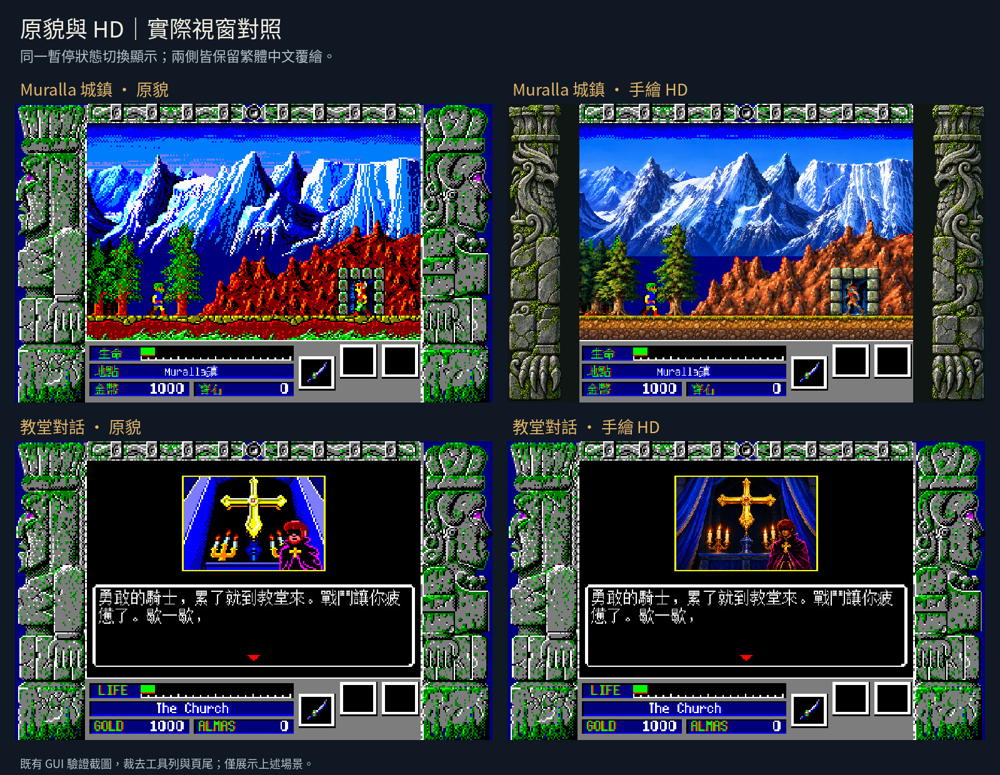
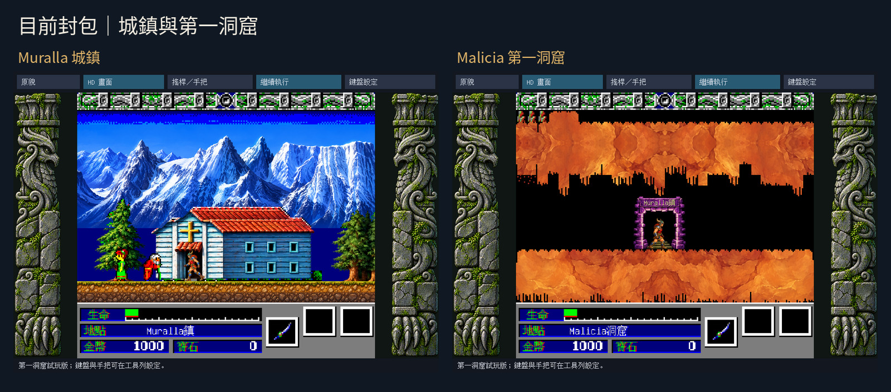
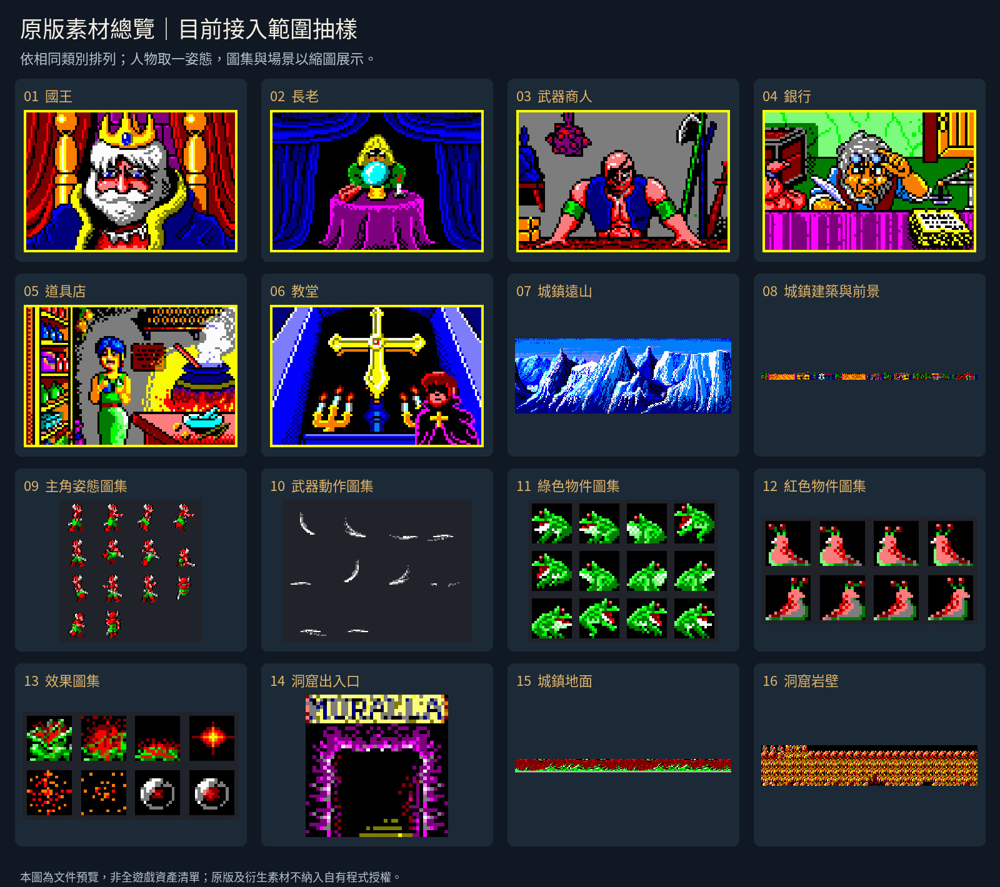
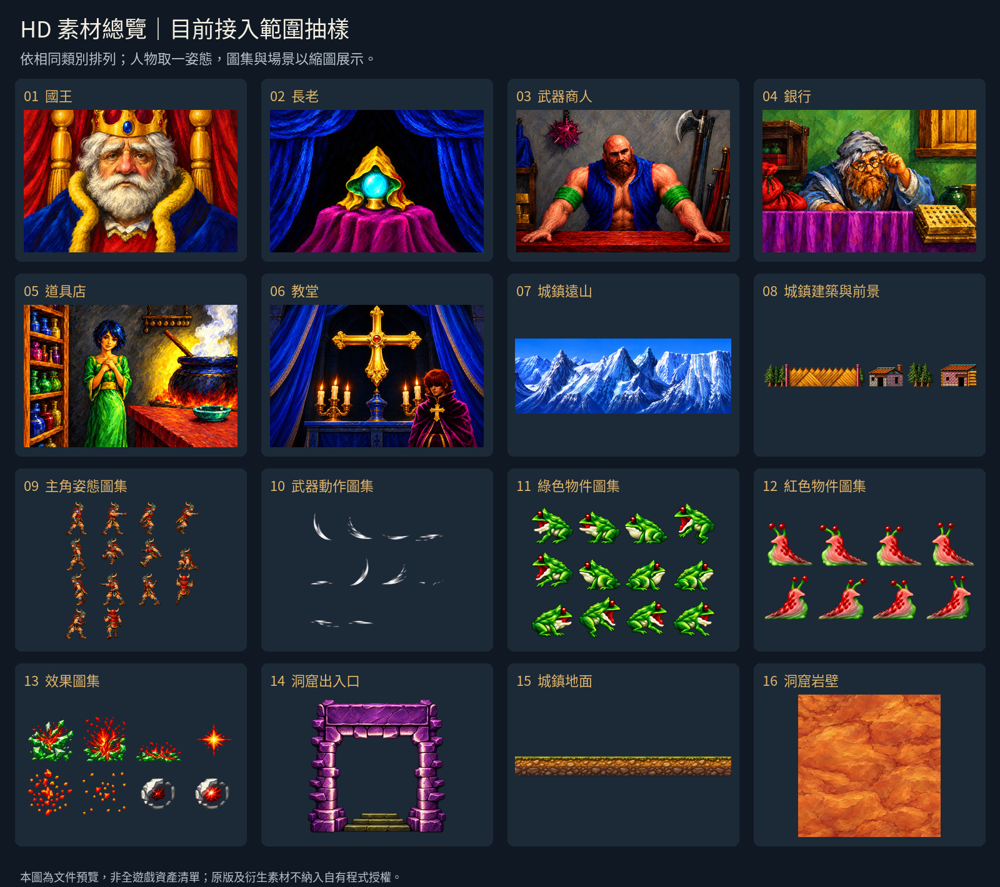
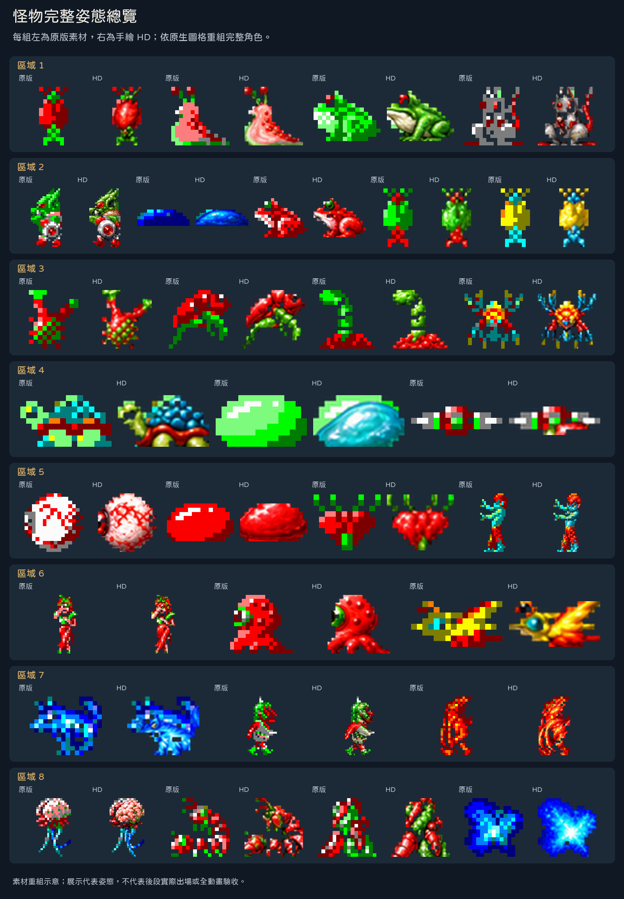
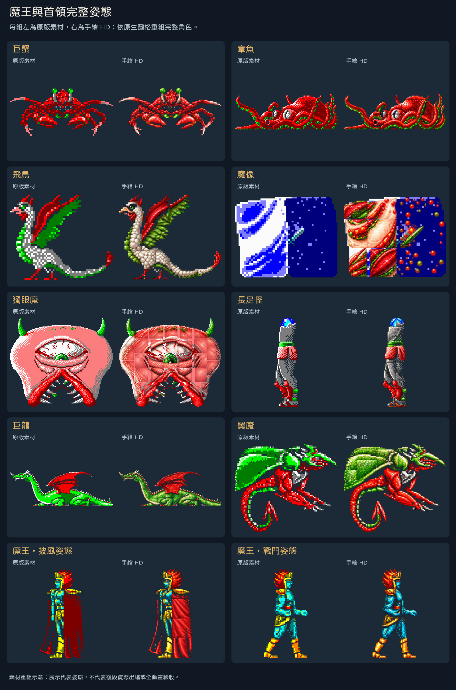

# 神劍封魔 Zeliard

## 遊戲簡介

《神劍封魔》是一款橫向動作角色扮演遊戲，結合城鎮交談、裝備補給與地下迷宮探索。玩家以劍和魔法迎戰怪物，運用跳躍、攀繩與蹲下穿越洞窟，在岔路與平台之間尋找前進的道路。

城鎮是冒險的補給站。向居民打聽消息，到商店選購武器與魔法物品，再帶著準備好的裝備進入迷宮。探索、戰鬥、回城整裝，構成遊戲的主要節奏；途中取得的金幣與寶石，也能用來支應下一段旅程。

## 故事背景

公主遭邪惡的魔龍化為石像，王國的繁榮也受到威脅。為了拯救公主，你接受邪靈的挑戰，帶著人民的期待與神靈的祝福，踏入地下迷宮。

從城鎮出發，居民的消息、商店的裝備與手中的劍，都是迎向未知的準備。離開有人煙的地方後，等待你的是錯綜的洞窟、盤踞其中的怪物，以及必須親自闖過的險路。救回公主的旅程，就從這一步開始。

故事與城鎮探索描述改寫自當年中文手冊《神劍封魔》第1頁「前言」、第6頁操作說明及第7至10頁「開始遊戲」與商店介紹；動作描述亦依本專案已實際走過的第一洞窟操作。手冊來源為`珍084-神劍封魔.rar`內的`珍084-神劍封魔/SCAN0357_003.jpg`、`SCAN0357_005.jpg`、`SCAN0357_006.jpg`及`SCAN0357_007.jpg`。原文核對與雜湊見[手冊證據](RESEARCH-LOG.md#2026-10-18輸入盤點與中文手冊初讀)，掃描檔留在本機。

## 繁體中文與 HD 版本

使用 dosgolem 直接執行 DOS《神劍封魔》，在原版畫面上疊加繁體中文與 HD，並加入可綁定藍牙、USB 手把的工具列。執行與覆繪參考《銀河超能力戰記》中文化專案，工具列參考《三國演義》重製版。

正式版 [1.0.1](https://github.com/wicanr2/zeliard_cht/releases/tag/v.1.0.1-20261021) 已結案。提供「原版＋中文（CHT）」及「原版＋中文＋HD（CHT-HD）」兩套三平台完整包。CHT保留原版美術，不附HD圖庫；CHT-HD預設開啟手繪HD，可從工具列切回原貌。兩版都包含原版遊戲、圓體中文、配樂音色改善及鍵盤／手把設定，存檔相容。交付方式見[規格051](docs/spec/051-dual-edition-release.md)。

HD 圖樣搜尋已加速，並補上持盾受擊後特殊姿態的高清接入。正常接敵變色與後續姿態均保留 HD 背景和角色，原版移動速度與規則不變。修正與驗證範圍見[規格052](docs/spec/052-hd-runtime-damage.md)。

| 範圍 | 目前狀態 |
|---|---|
| 城鎮與室內 | 沿用既有場景，補齊八種室內圖庫、居民、城鎮地形及交談後景；接縫、遮擋與正常到達待人工驗收 |
| 洞窟 | 沿用11組地形、門框與物件；八組敵人、十組首領及第二階段模板均有HD圖面 |
| 主角與武器 | 保留既有完整姿態，加入主角230個原生圖塊與三組刀光301個圖塊的組裝；未知來源安全退回 |
| 片頭、結局與介面 | 已接入補繪插畫、頭像表情、幻影階段、結局合成、裝備物品圖示與法術效果 |
| 整合狀態 | 新版正常進入第一洞窟，已重錄代表中文對話、原貌／HD切換及操作設定；全遊戲每幀仍未驗 |
| 平台封包 | 兩版各有Linux AppImage、Windows ZIP及macOS通用ZIP；Linux啟動、Wine輔助啟動及六包內容檢查完成 |

HD版收錄已盤點的城鎮、室內、洞窟、人物、敵人、首領、裝備法術、片頭與結局補圖，來源與接入見[規格050](docs/spec/050-manual-hd-delivery.md)。未知或不符來源保留原貌；不以完整資料包或第一洞窟錄影宣稱全遊戲翻譯、每幀HD或完整通關已驗收。

中文採用較圓潤的[jf open 粉圓2.1](https://github.com/justfont/open-huninn-font/releases/tag/v2.1)，在工具列、對話、選單與狀態列依顯示尺寸合成柔邊，保留原字距及文字區域。字型採OFL-1.1，授權全文隨本機包附上。製作方式見[字型工具](tools/prepare_rounded_font.py)。

配樂改用原版 AdLib 驅動與可替換的 Nuked-OPL3 音源，保留原曲。封包採實際時間推進，卡頓時最多追趕100毫秒，暫停及失焦不追趕。實體USB／藍牙手把、Windows與macOS真機尚未驗收；Windows已通過Wine輔助啟動，macOS已驗通用架構及封包結構。詳見 [VERIFICATION-MATRIX.md](VERIFICATION-MATRIX.md)。

## 原版與 HD 畫面



左側為原版美術，右側為手繪 HD。每組取自同一暫停狀態的實際視窗，兩側皆開啟繁體中文覆繪。教堂圖展示當時的肖像覆繪，邊框與狀態列仍保留原貌；這些截圖只呈現已驗證的場景。



前版封包的 Muralla 城鎮與 Malicia 第一洞窟實際截圖，保留工具列與狀態列。可從工具列切換原貌／HD、選擇手把及設定鍵盤。本頁截圖保留前版，新版實錄見下方推廣片。

## 素材總覽

以下兩張圖保留前版相同的16個類別，展示當時接入的原版來源與HD圖面。人物各取一個姿態，主角、武器及動態物件採圖集抽樣；城鎮地面與洞窟岩壁的原版圖取自場景。本批未重新抽樣或拍攝，這兩張圖不能代表新增素材的完整範圍。

### 原版素材總覽



### HD 素材總覽



圖面來源、裁切範圍與 SHA-256 保存於 [圖片來源清單](docs/images/provenance.json)，由 [製圖工具](tools/readme_images.py) 從本機素材重建。本頁圖片是依使用者要求加入的文件預覽；原版與衍生美術不適用自有程式的授權，完整解析度素材仍留在本機。

### 怪物與魔王總覽





每組左側為原版，右側為既有手繪 HD 素材，已將零散圖格重組為完整角色。上圖涵蓋八個區域的30組代表姿態，下圖展示10組首領姿態，包含魔王的披風與戰鬥兩種姿態；數量不等於敵人種類數。HD透明處保留原版下層，部分既有素材接縫仍可見。

這些是素材重組圖，後段實際出場與完整動畫仍待人工檢視。首領標題依外觀描述，不作官方譯名。布局參考Kuro-chan整理、由[nolanvenhola/zeliard](https://github.com/nolanvenhola/zeliard/tree/c23b5f91ad31eb75b2f63a312a42e161e26096d8/4_Resources/Sprites/SpritersResource)保存的圖集與地圖；輸出像素取自本地原版與既有HD素材。固定布局見[重組配置](docs/images/creatures-layout.json)，來源與雜湊見[總覽來源清單](docs/images/creatures-provenance.json)，可用[製圖工具](tools/readme_creatures.py)重建。

## 開始遊玩

本機完整版放在 `dist-all/v.1.0.1-20261021/full-local/`，包含遊戲資料，未上傳GitHub。檔名以`Zeliard-v.1.0.1-20261021-`開頭：

| 平台 | 原版＋中文 | 原版＋中文＋HD |
|---|---|---|
| Linux x86_64 | `CHT-Linux-x86_64.AppImage` | `CHT-HD-Linux-x86_64.AppImage` |
| Windows x86_64 | `CHT-Windows-x86_64.zip` | `CHT-HD-Windows-x86_64.zip` |
| macOS Intel／Apple Silicon | `CHT-macOS-universal.zip` | `CHT-HD-macOS-universal.zip` |

前版封包保留在各自版號目錄。本版修正洞窟主角附近誤貼結局圖塊的顯示錯誤，重新編譯六個封包，並在Ada重錄遊玩片段與推廣片，詳見[規格055](docs/spec/055-cave-artifact-context.md)。

Windows解壓縮後開啟`Zeliard.exe`，macOS開啟`Zeliard-CHT.app`或`Zeliard-CHT-HD.app`。Linux可直接執行所選AppImage，也可在專案目錄啟動HD版：

```sh
bash tools/play.sh
```

原貌中文版使用`bash tools/play.sh --cht`。兩套包分開提供，安裝位置不影響共用存檔格式。

原生封包不需要Docker。若Linux缺少FUSE，可在新目錄以AppImage的`--appimage-extract`解開，再執行`squashfs-root/AppRun`。兩版已使用此方式啟動檢查。

工具列可開啟「搖桿／手把」及「鍵盤設定」，HD版另可切換原貌／HD。藍牙先在系統配對，USB手把先插入，再選裝置及綁定。鍵盤可重綁、解除、還原預設，兩種設定都會保存。

| 預設按鍵 | 操作 |
|---|---|
| 方向鍵 | 移動、跳躍、蹲下及選單 |
| 空白鍵 | 攻擊／交談 |
| Enter | 裝備頁 |
| Alt | 法術 |
| Esc | 原版暫停；設定頁內取消／返回 |
| F1／F2 | 原版音樂／音效開關 |
| F12 | 鍵盤設定 |
| Ctrl+Q，再按Y | 正常離開 |

包內附自建存檔SAVETEST，可按F7讀取後從Muralla鎮向右進入第一洞窟。存檔與操作設定保存在系統使用者設定目錄的 `Zeliard-CHT`：Linux為 `~/.config/Zeliard-CHT/`，Windows為 `%AppData%\Zeliard-CHT\`，macOS為 `~/Library/Application Support/Zeliard-CHT/`。可用 `ZELIARD_USER_DIR` 指定其他目錄。

隨修正版附上的影片使用v.1.0.1在ada的NVIDIA RTX 2000 Ada實際錄製，以VirtualGL硬體繪圖及NVENC擷取。包含城鎮、教堂中文對話、原貌／HD切換與第一洞窟操作，另展示工具列設定。詳細來源見[規格053](docs/spec/053-ada-gameplay-promo.md)。

| 影片 | 本機路徑 |
|---|---|
| 連續遊玩，保留同期遊戲音效 | `dist-all/v.1.0.1-20261021/promo/Zeliard-v.1.0.1-20261021-ada-gameplay.mp4` |
| 60秒推廣片，1280×720，原版標題曲配樂 | `dist-all/v.1.0.1-20261021/promo/Zeliard-v.1.0.1-20261021-promo.mp4` |

各版檔案大小與SHA-256見同版`SHA256SUMS.json`，影片檢查在`promo/`，封包檢查在`smoke/`。v.0.4.0影片保留原身份。封包與影片包含原版資料、音樂及衍生美術，只留本機，不上傳或公開散布。

洞窟的插畫片段會核對母圖的可見來源，避免小圖樣誤貼到主角或背景。舊1.0.0封包及影片保持原身份；本版影片來自修正後程式的新Ada實錄。

三平台雙版本建置入口為[tools/build_dual_release.sh](tools/build_dual_release.sh)，使用Docker與固定的本地原版、字型及HD圖組，拒絕覆寫既有輸出。錄影、影片與六包核對入口見[規格051](docs/spec/051-dual-edition-release.md)。版號由[VERSION](VERSION)指定；目前狀態見[CONTEXT.md](CONTEXT.md)。

## 開發方向

- 以固定版本的原版程式為行為依據，使用 dosgolem 建立可重播的啟動、操作與畫面證據。
- 中文譯名參考當年中文手冊；文字來源與排版先驗證再接入。
- 原貌保留獨立基準，HD沿既有3倍畫布，以手繪圖面覆繪，不改遊戲規則。
- 工具列提供手把裝置選擇、按鍵綁定、設定保存與斷線處理。藍牙配對由作業系統完成。

## 本地資料

遊戲與手冊保留在本機，未納入 Git。遊戲包來自使用者指定的[線上 DOS 遊戲頁面](https://legacy.dos.zczc.cz/games/%E7%A5%9E%E5%89%91%E5%B0%81%E9%AD%94/)。執行與測試需要合法持有的原版資料，來源清單見 [CONTEXT.md](CONTEXT.md)。

分析、建置與測試使用 Docker。開工規則與文件入口見 [AGENTS.md](AGENTS.md)，實際命令與結果記在 [WORKLOG.md](WORKLOG.md)。

## 進階啟動選項

Linux封包可在啟動命令後加 `-audio off` 關閉播放。`-realtime` 保留本次已確認的100毫秒追趕模式；原始命令列仍可用固定更新方式供研究。

原生資料定位見 [bundle.go](cmd/zeliard-preview/bundle.go)，音源及封包契約見 [規格033](docs/spec/033-original-music-release.md)。Nuked-OPL3依其LGPL條款提供獨立可替換函式庫與來源，自有程式仍採RRSAL-1.0。

## 授權

自有程式與文件採 [RRSAL-1.0](LICENSE)，屬 source-available 專案。非商業用途免費，允許實況與影片分潤，商業使用另洽。原版遊戲、手冊、音樂、美術及字型不在此授權範圍內。第三方元件依各自授權使用。
